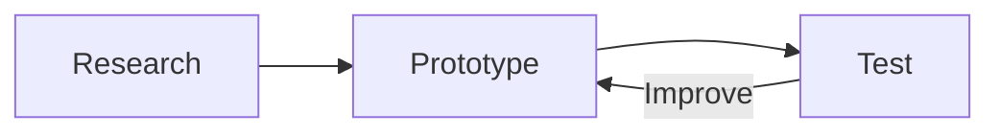
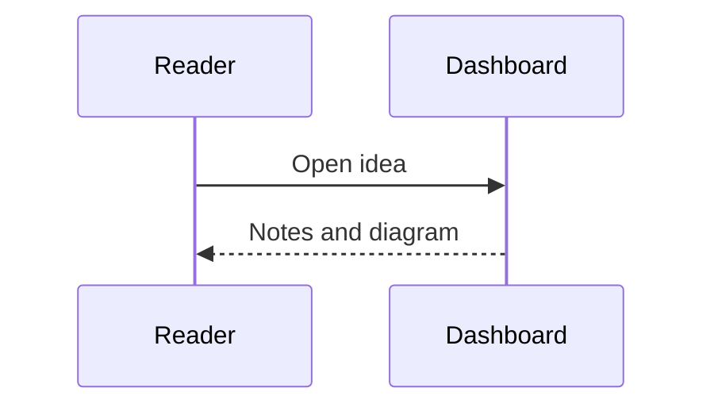

# Markdown in News and Ideas

Open a news story or project idea, choose **Edit**, and write Markdown in **Full text / notes**. Automated producers put the same source in the existing `content` string. The v1 feed and backup format is unchanged; Markdown source is preserved through editing, search, ingestion and backups. Titles, summaries, next steps and planning notes remain plain text.

## Text, links and tables

````markdown
## Background

**Bold**, *emphasis*, ~~strikethrough~~ and `inline code`.

[Read the source](https://example.com/article)

https://example.com/another-article

[Jump to background](#background)

- A useful point
- [x] Completed research
- [ ] Next experiment

> A quoted passage

| Option | Next step |
| --- | --- |
| Prototype | Test with a reader |

```js
console.log('Hello');
```
````

Single line breaks and blank paragraphs are preserved. HTTP(S) and dashboard-relative asset links are clickable. External links open a new tab. Heading links scroll within the details panel. Long code and tables scroll sideways on phones.

## Images

```markdown


```

Commit the local file to `public/media/story.jpg`; use `media/story.jpg` in Markdown. HTTPS images may be remote. Give every image useful alt text. Broken images display that text rather than duplicating the story title. Images resize to the panel without cropping.

## Mermaid diagrams

````markdown



````

Mermaid renders locally, without a CDN, using strict security settings. Diagram configuration directives such as `%%{init: ...}%%` and YAML frontmatter are not supported. Keep diagrams below 50,000 characters and 500 edges. Every diagram retains its expandable **Mermaid source**. If syntax is invalid or rendering fails, the source and an error message remain readable; the rest of the story still works.

## Videos

Put a labeled video link in its own paragraph. A link in a sentence stays a normal link.

```markdown
[Watch the bundled sample clip](media/markdown-demo.mp4)

[Watch the prototype demo](media/demo.mp4)

[Watch an external demo](https://example.com/demo.webm)

[Watch on YouTube](https://www.youtube.com/watch?v=dQw4w9WgXcQ)

[Watch on Vimeo](https://vimeo.com/76979871)
```

MP4, WebM, OGV and OGG file extensions are recognized, including HTTPS URLs with query parameters. Playback depends on the browser's codec support; MP4 with H.264 is a practical cross-device choice. Videos have playback controls, support inline phone playback, and never autoplay. Files are not fetched until needed. `[Watch](URL)` and `` both accept supported video URLs.

YouTube watch, Shorts, `youtu.be` and embed links are recognized, as are Vimeo numeric video links. YouTube/Vimeo show a **Play** button and load the external player only when selected. An **Open video** link remains available if the provider blocks embedding. Other provider links remain clickable links; arbitrary iframes are not supported.

## Feeds and offline use

Use a normal JSON string with escaped newlines:

```json
{
  "id": "ideas:prototype-notes",
  "section": "ideas",
  "type": "idea",
  "title": "A prototype to try",
  "description": "Notes, an illustration and a demo.",
  "content": "## Prototype\n\n[Background](https://example.com)\n\n\n\n```mermaid\nflowchart LR\n  Idea --> Build\n```\n\n[Watch](media/demo.mp4)",
  "status": "explore"
}
```

This is an item to add to the existing `{"version":1,"items":[...]}` feed; preserve unrelated items and follow [feed-format.md](feed-format.md) and the owner's publishing authorization. Do not put credentials or private material in this public site.

Markdown, Mermaid and all committed local assets are cached by the PWA once it reports **Ready for offline use**. Large local video files increase the offline download size. Remote images and external video players require a connection; they are not added to the app's offline cache. A new commit triggers a Pages build; installed apps receive its **Update** prompt.

Raw HTML, including `<iframe>`, `<video>` and `<script>` tags, is displayed as text. Use the Markdown syntax above for supported media. JavaScript/data URLs, event handlers and configuration hidden in untrusted content cannot bypass the renderer.
